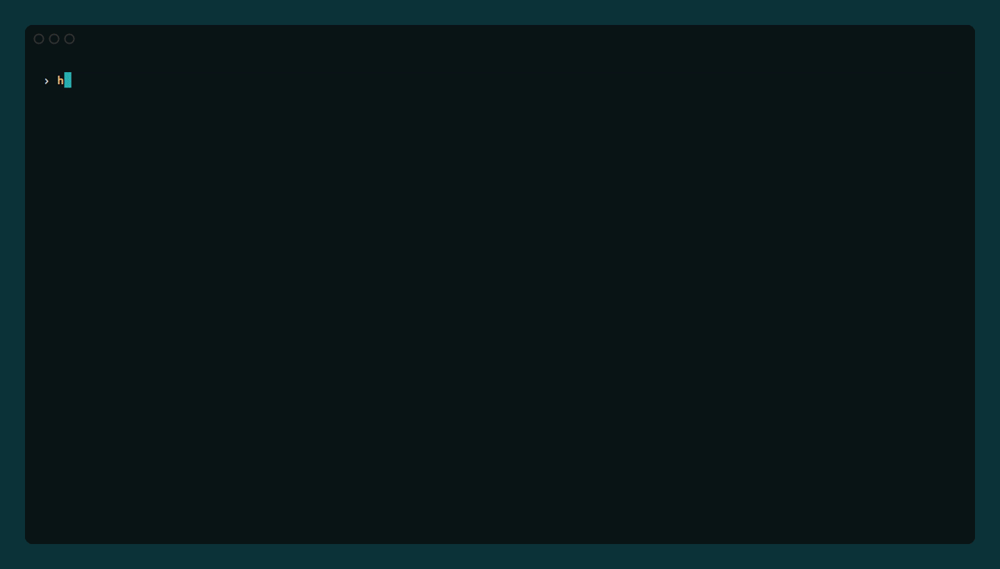
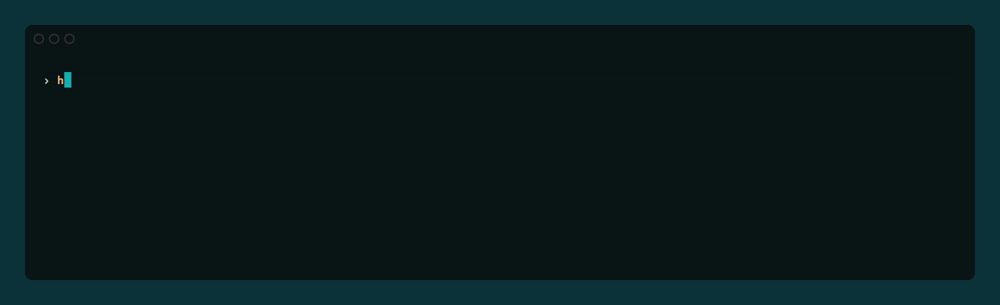

# Holocron

**Holocron is your personal work archive.**

During a working day you do dozens of small and medium things: investigate
problems, make decisions, finish work across several projects. By the time you
need a weekly update, a one-on-one, a quarterly review, or an answer to "what
did I do last Tuesday?", that context is scattered across Git history, chat,
tickets and memory.

Holocron makes capturing that context cheap enough to actually do it, keeps it
in a local SQLite file you own, finds it again with full-text search, and turns
it into deterministic reports that always show which entries they came from.



## Why Holocron

- **Local first.** No account, no server, no telemetry. Nothing leaves your
  machine unless you explicitly ask for AI rewriting of a report.
- **Capture in one line.** `holocron add "Fixed the deployment issue +infra #deploy"`
  files it under a project and a tag as you type.
- **Search that works.** Full-text search over text, projects and tags,
  combined with date, project, tag, type and mark filters.
- **Reports without AI.** Day, week, staff, one-on-one and quarterly reports
  built from explicit metadata, each item traceable to the entries behind it.
- **Works the way you do.** A fast interactive archive in the terminal, and a
  scriptable CLI with JSON output for everything it shows.
- **More than one computer.** Optional end-to-end encrypted sync through a
  folder you already sync (OneDrive, Dropbox, iCloud Drive), with no server.
- **Your data is not trapped.** Markdown and versioned JSON export, verified
  and optionally encrypted backups, and a documented schema.

## Install

Holocron is a single binary for Windows, macOS and Linux (amd64 and arm64),
with no runtime dependencies.

- **Download** the archive for your platform from the
  [releases page](https://github.com/Unscheduled-Maintenance/Holocron/releases/latest),
  extract `holocron` (or `holocron.exe`) and put it on your `PATH`.
- **Or, with Go 1.27.1 or later:**

  ```bash
  go install github.com/Unscheduled-Maintenance/Holocron/cmd/holocron@latest
  ```

There is nothing to set up: the archive is created the first time you use it.

## Quick start

Capture a few things as they happen. `+project` and `#tag` are optional
shorthand, and a `Type:` prefix says what kind of entry it is:

```bash
holocron add "Investigated an S3 bucket policy issue +aws #security"
holocron add "Decision: keep the weekly deploy window +infra"
holocron add "Win: shipped the new backup job +infra"
holocron add "Follow-up: ask platform about ARM capacity"
```



Find them again:

```bash
holocron today              # today's entries
holocron week               # this week
holocron search s3          # full-text search
holocron list --open        # problems and follow-ups still open
```

Turn them into an update you can paste somewhere:

```bash
holocron report staff                 # this week's team update
holocron report one-on-one            # wins, decisions, open items, friction
holocron report staff --ids --explain # which entries, and why
```

Or just run `holocron` for the interactive archive: browse, search as you
type, edit, and generate reports without leaving the terminal. Press `?`
inside it for the keys.

Optionally, encrypt backups that leave the computer and sync your archive
between computers:

```bash
holocron backup -o /mnt/usb/ --passphrase
holocron sync init ~/OneDrive/Holocron     # then "sync join" on the others
```

## Learn more

The [Holocron wiki](https://github.com/Unscheduled-Maintenance/Holocron/wiki)
is the full guide:

- [Capturing entries](https://github.com/Unscheduled-Maintenance/Holocron/wiki/Capturing-Entries):
  types, shorthand, report marks, timestamps and the editor form
- [Browsing and searching](https://github.com/Unscheduled-Maintenance/Holocron/wiki/Browsing-and-Searching):
  date ranges, filters and search syntax
- [Reports](https://github.com/Unscheduled-Maintenance/Holocron/wiki/Reports):
  what each report shows and how items are chosen
- [The interactive archive](https://github.com/Unscheduled-Maintenance/Holocron/wiki/Interactive-Archive):
  every key
- [Backup and restore](https://github.com/Unscheduled-Maintenance/Holocron/wiki/Backup-and-Restore)
  and [Sync between computers](https://github.com/Unscheduled-Maintenance/Holocron/wiki/Sync)
- [Configuration](https://github.com/Unscheduled-Maintenance/Holocron/wiki/Configuration),
  [Scripting](https://github.com/Unscheduled-Maintenance/Holocron/wiki/Scripting-and-Shell-Integration)
  and [Troubleshooting](https://github.com/Unscheduled-Maintenance/Holocron/wiki/Troubleshooting)

`holocron --help` and `holocron <command> --help` describe every command and
flag.

## Privacy

Holocron never contacts a network service on its own. Your entries leave the
computer only when you ask for an AI-rewritten report (just the entries that
report selected, after you confirm), or as encrypted files in a sync folder you
chose. The archive itself is a plain SQLite file: protect it with full-disk
encryption if your entries are sensitive. [docs/security.md](docs/security.md)
sets out the threat model.

## Contributing

The design is described in [docs/architecture.md](docs/architecture.md) and the
[architecture decision records](docs/adr/README.md). The JSON export and sync
folder formats are documented in [docs/export-format.md](docs/export-format.md)
and [docs/sync-format.md](docs/sync-format.md). Build with
`go build ./cmd/holocron` and test with `go test ./...`.

## Licence

Holocron is released under the [MIT Licence](LICENSE).
